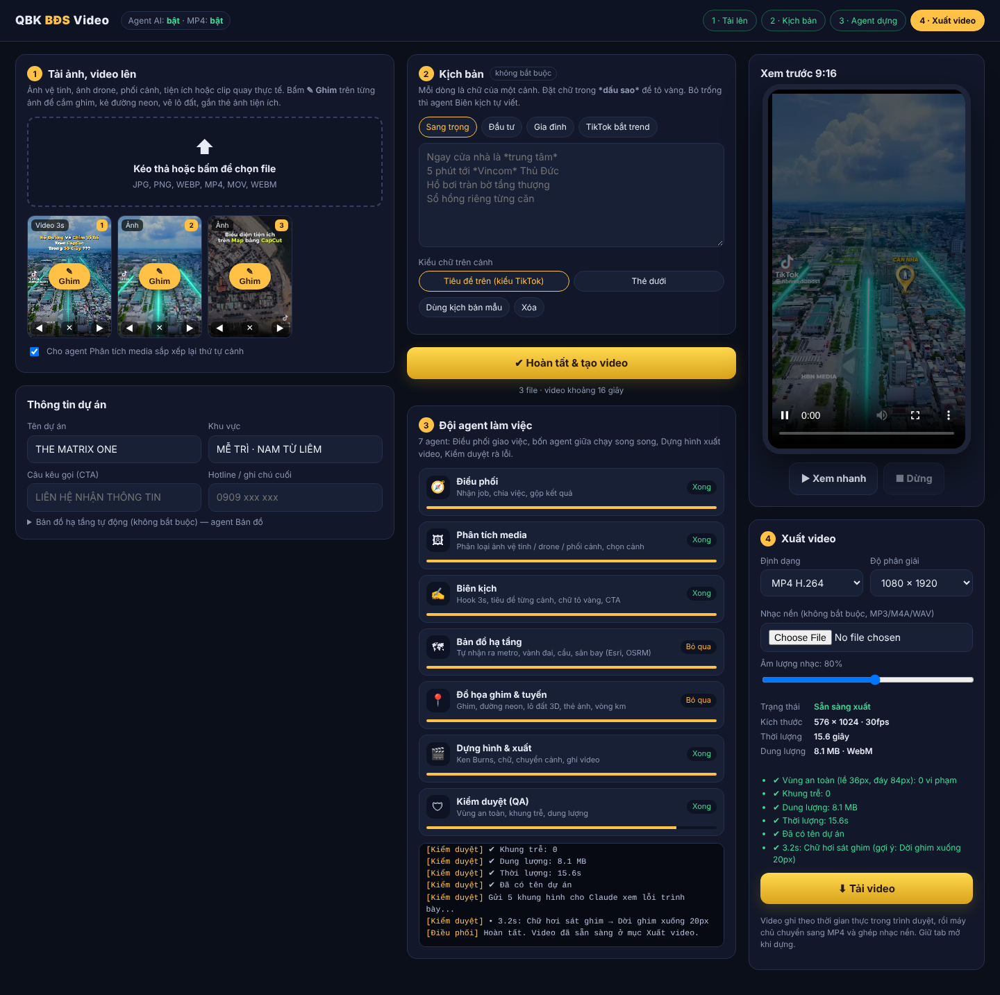

# QBK BĐS Video

App tạo video dọc 9:16 giới thiệu dự án bất động sản bằng một đội 7 agent:
tải ảnh/video, thêm kịch bản (không bắt buộc), bấm **Hoàn tất** là có video, rồi **Xuất MP4 1080×1920** có nhạc nền.



## Mở app trên claude.ai (không cần cài gì)

**https://claude.ai/artifact/UMaA2yMyDeAEbZT5R5bgZr**: mở trên điện thoại hoặc máy tính, giống QBK Studio.
- Agent AI dùng Claude của tài khoản đang mở (lần đầu claude.ai hỏi cho phép).
- Video ghi MP4 ngay trên trang (Chrome, Safari; trình duyệt không hỗ trợ thì WebM), nhạc nền trộn lúc ghi, bấm Tải video để lưu.
- Cảnh bản đồ vệ tinh tự động không chạy trên claude.ai (trang không được gọi máy chủ bản đồ); dùng bản chạy trên máy bên dưới.

Đăng lại sau khi sửa: `node scripts/build-artifact.mjs` rồi đăng `dist/artifact/index.html` (kèm `map-engine.js`) lên cùng link.

## Chạy trên máy (đủ tính năng: bản đồ vệ tinh, MP4 1080×1920)

Cần **Node.js 20+** và **FFmpeg** (`ffmpeg -version` chạy được).

```bash
npm install
export ANTHROPIC_API_KEY=sk-ant-...   # Windows PowerShell: $env:ANTHROPIC_API_KEY="sk-ant-..."
npm start
```

Mở **http://localhost:3000** bằng Chrome hoặc Edge.

Hoặc bằng Docker (đã gồm FFmpeg):

```bash
docker build -t qbk-bds-video .
docker run -p 3000:3000 -e ANTHROPIC_API_KEY=sk-ant-... qbk-bds-video
```

Góc trên giao diện cho biết **Agent AI** và **MP4** đang bật hay tắt.
- Không có khóa API: app vẫn chạy, agent Biên kịch dùng kịch bản mẫu, không có phân tích ảnh và kiểm duyệt bằng AI.
- Mở thẳng `app/index.html` không qua máy chủ: chỉ xuất được WebM, không có AI.

## Cách dùng

1. **Tải lên** ảnh/video (vệ tinh, flycam, phối cảnh, nội thất...). Bấm **✎ Ghim** trên ảnh để cắm ghim, kẻ đường neon, vẽ lô đất 3D, gắn thẻ ảnh.
2. Nhập **tên dự án, khu vực, CTA**. Có **tọa độ** thì agent tự dựng cảnh bản đồ hạ tầng (ga, TTTM, bến xe, sân bay, cầu).
3. **Kịch bản** (không bắt buộc): mỗi dòng một cảnh, `*chữ*` để tô vàng. Bỏ trống thì Claude tự viết theo nội dung ảnh.
4. Bấm **Hoàn tất & tạo video**, xem 7 agent làm việc.
5. **Xuất video**: chọn MP4 1080×1920, thêm nhạc nền nếu muốn, bấm Tải video.

## Đội agent

| # | Agent | Chạy ở đâu | Làm gì |
|---|---|---|---|
| 1 | Điều phối | Trình duyệt | Giao việc, gộp kết quả, báo tiến độ |
| 2 | Phân tích media | Máy chủ · Claude (đọc ảnh) | Phân loại flycam / vệ tinh / phối cảnh / nội thất..., chấm điểm, sắp thứ tự cảnh |
| 3 | Biên kịch | Máy chủ · Claude | Câu mở đầu, chữ từng cảnh có từ khóa tô vàng, câu chốt, CTA; chỉ chuẩn hóa nếu bạn đã có kịch bản |
| 4 | Bản đồ hạ tầng | Trình duyệt · Photon, OSRM, Esri | Tự tìm hạ tầng quanh tọa độ, dựng cảnh vệ tinh theo chủ đề |
| 5 | Đồ họa ghim & tuyến | Trình duyệt | Ghim, đường neon, lô đất 3D, thẻ ảnh, vòng bán kính |
| 6 | Dựng hình & xuất | Trình duyệt + máy chủ · FFmpeg | Ghi video 30fps, chuyển MP4 H.264 1080×1920, ghép nhạc |
| 7 | Kiểm duyệt | Trình duyệt + máy chủ · Claude | Kiểm tra vùng an toàn tự động + Claude xem khung hình tìm lỗi trình bày |

Agent AI dùng model `claude-opus-5-5` với đầu ra JSON theo khuôn; nếu bị bộ lọc an toàn từ chối, máy chủ tự chạy lại bằng model dự phòng (`fallbacks: "default"`).

## Cấu trúc

```
app/            giao diện (index.html) + agent bản đồ (map-engine.js)
server/         máy chủ Express: agents.js (Claude), export.js (FFmpeg), index.js (API)
skills/         4 skill đã học (zip + 3 video mẫu)
docs/           kế hoạch hệ thống, ảnh xem trước
test/           kiểm thử máy chủ: npm test
```

API: `GET /api/health` · `POST /api/agents/media` · `POST /api/agents/script` · `POST /api/agents/qa` · `POST /api/export` (multipart: `video`, `music`, `res`).

## Lưu ý
- Cảnh bản đồ cần mạng tới `server.arcgisonline.com`, `router.project-osrm.org`, `photon.komoot.io`, có dòng ghi nguồn Esri/OSM theo yêu cầu giấy phép. Dùng thương mại hãy kiểm tra điều khoản Esri.
- Video ghi theo thời gian thực: giữ tab mở và đang hiển thị khi dựng.
- Kế hoạch chi tiết: [docs/KE-HOACH.md](docs/KE-HOACH.md).
